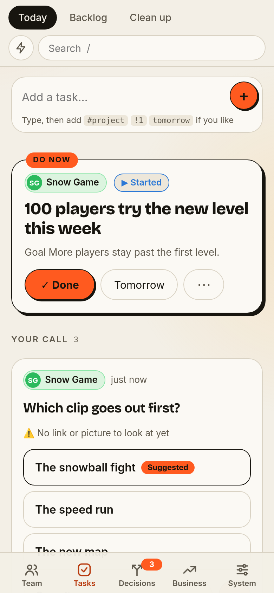
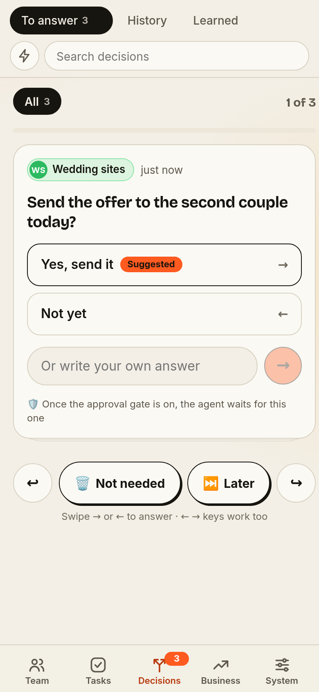

# Beacon

A one-person hub for a studio where AI coding agents do most of the work. Every agent session on every machine
reports in; the hub turns that into the few things a product owner needs on a phone: what to work on next
(**Tasks**), what only they can decide (**Decisions**, one card at a time), what the agents shipped and what it cost
(**Team**, **Usage**, **AI jobs**), and whether the machines and background jobs are healthy (**Machines**).

<p>
  
  
</p>

- **No dependencies (for now).** The live hub is a Python standard library HTTP server over SQLite; the pages are
  plain JS and CSS with no build step. It is moving to TypeScript and Postgres in stages (see Test, below).
- **Agents are first-class users.** They write tasks and ask questions through the same JSON API (and the `tasks`
  CLI in `client/`); an approval gate holds risky actions (sends, deploys, deletes) until the owner says yes.
- **Collectors, not scrapers.** `collector/collect.py` runs on each machine, reads local agent logs (Claude Code,
  Codex, OpenCode, Hermes) and pushes new events plus a live snapshot every 10 s.

```
 laptop ──┐   collector/collect.py (every 10 s)        hub/server.py
 gamer  ──┤
 devbox ──┼── reads local agent logs, POSTs new ──────▶ SQLite + JSON API + web/
 cloud  ──┘   events + a live snapshot (bearer token)  127.0.0.1:4829 ◀─ tailscale serve
```

## Run it

Python 3.11+, nothing to install.

```sh
TASKS_TOKEN=demo USAGE_TOKEN=demo python3 hub/server.py   # http://127.0.0.1:4829
TASKS_TOKEN=demo python3 scripts/demo.py                    # made-up tasks and decisions to look at
python3 collector/collect.py --dry-run                      # what this machine's collector would send
```

Open http://127.0.0.1:4829/tasks and http://127.0.0.1:4829/decisions.

## Test

```sh
scripts/check                       # everything below, in order; red = not done
scripts/check --fast                # all but the test suite (~20 s instead of ~3 min)
git config core.hooksPath .githooks # once per clone: every push runs `scripts/check --fast` first
```

`scripts/check` (needs Python 3.12+, [uv](https://docs.astral.sh/uv/) and Node for `npx`):

| Step | Tool | Rule |
|---|---|---|
| Lint | `ruff check` (`ruff.toml`) | zero findings: syntax errors, undefined and unused names |
| Quality ratchet | `scripts/ratchet.py`: ruff with `ruff.strict.toml` (complexity 15, size limits, bugbear, security, imports, modern syntax) and Biome on `web/` (`biome.json`) | new code meets the strict rules; old code may not get worse. Findings are counted per rule in `quality-baseline.json`; a fix lowers the count with `scripts/ratchet.py --update`, nothing ever raises it |
| Type errors | `scripts/scores.py types`: pyright, basic mode (`pyrightconfig.json`) | errors counted per area (hub, collector, client, scripts) in `quality-baseline.json` `at_most`, may only go down; a new module starts with `# pyright: strict` |
| Copy-paste | `jscpd` (`.jscpd.json`) | under 1% duplicated lines (0.27% on 2026-11-24) |
| Checks not loosened | git diff against `origin/main` | a change may not delete or skip tests, add `noqa` / `biome-ignore` / `type: ignore` / `pyright: ignore`, edit a check's config or loosen the baseline (a count up, a score down), unless a commit line `Quality-exception: <why>` puts the reason on record |
| Tests and coverage | `coverage run -m unittest discover -s tests` (`.coveragerc`, pinned in `requirements-dev.txt`), then `scripts/scores.py coverage` | runs on `config.example.json` only; line and branch coverage per area (hub, collector, client) in `quality-baseline.json` `at_least`, may only go up |
| Layout | `scripts/layout_check.py`: a throwaway hub with `scripts/demo.py` data, every page drawn in Chrome (`playwright-core`, pinned in `package.json`) at 390 px and 1280 px, Paper + English and Night + Czech, with the shell's run-time states forced (a three-digit Decisions count, its pulse) | the shared header has the same boxes on every page; no header pill wider than its text; no sideways scroll; no text in a system font (it differs per device, so wrapping does too); no progress bar that disagrees with its "N of M"; no missing value drawn as a word (`null`, `undefined`, `NaN`). `tests/test_shell_isolation.py` adds the static half: a page's own sheet may not style the shared header's classes by accident |

### The TypeScript workspace (`ts/apps/`, `ts/packages/`)

Beacon is moving to TypeScript and Postgres in stages ([design note](docs/design/2026-11-ts-migration.md)). Until the
move ends, the Python hub above is the live app; the new one grows beside it in one npm workspace:

| Folder | What |
|---|---|
| `ts/apps/web` | Next.js pages, built as a static export (`out/`, served under `/next/` until a page switches) |
| `ts/apps/api` | the Fastify API (`src/server.ts`, `127.0.0.1:4832`) and the background worker (`src/worker.ts`, `:4833`); each answers `GET /healthz` |
| `ts/packages/contracts` | Zod schemas of every request and response, shared by pages and API |
| `ts/packages/db` | the Postgres pool (`BEACON_DATABASE_URL`; unset = no database, health says `db: "off"`) |

```sh
npm ci --ignore-scripts             # the whole workspace, lockfile only, nothing newer than 7 days
scripts/check-ts                    # tsc strict, typescript-eslint strictTypeChecked, Biome format, knip, Vitest + coverage floors, the builds
node ts/apps/api/build.mjs && node ts/apps/api/bundle/server.js   # http://127.0.0.1:4832/healthz
```

`scripts/check` runs `scripts/check-ts --fast` locally; CI runs it as its own job.

CI runs the same `scripts/check` on every push and pull request (`.github/workflows/ci.yml`); Dependabot keeps
the Actions current.

### AI UI review: the bugs no rule names yet (task 1998)

Rules catch only what someone already named. `scripts/ui_review.py` is the sensor for the rest: a throwaway hub
(the layout check's) in its data states (empty; full: `demo.py --many --long`, 38 tasks, 36 decisions, the longest
text agents write), every page at phone and desktop size, light English and dark Czech, plus the moments a tap opens
(a decision mid-answer). `scripts/ui_states.mjs` saves each as screen-sized pictures with the page's text and controls,
and taps every button to list the ones that change nothing. Then one Sonnet call per page, state and look reads both
sizes against the brief in `.claude/agents/ui-reviewer.md` (numbers add up, nothing clipped or overlapping, readable
contrast, every label translated, honest empty states, controls that act) and answers findings as JSON.

```sh
scripts/ui_review.py                         # ~40 calls, ~$1.50 of subscription use, ~25 min; findings.json
scripts/ui_review.py --only /decisions       # one page
scripts/ui_review_seeded.py key.json         # plant known bugs (patches + a key), review each, score
```

- Seeded test (2026-11-24): 5 bugs planted blind by an agent that never saw the brief (dark-look contrast, a
  heading count off, clipped text, an English button in Czech, buttons under a card at 390 px): 4 caught, twice,
  each hit checked by eye against its planted bug (the scorer matches page + kind, so it also credits a finding of
  that kind that was there before). The miss: a heading count that needs adding up the rows under it.
- False alarms: of 20 sure findings sampled evenly from a run on main and checked by eye against the pictures and
  page text, 17 were real (the 3 others: two deliberate "…" shortenings on the phone graph, a toast that shows for a
  moment). Low-confidence findings are not posted.
- First run on main: 199 findings (71 sure), among them the Outreach page printing "nullnull", the header's
  language button wrapping to a second row at 1280 px on System pages, English text left on Rank, Team and Usage in
  Czech, a hint pointing to an "Up next" section that no longer exists.
- The rules are the gate, the AI is the sensor: a real finding is fixed and becomes a rule in
  `scripts/layout_check.mjs` plus a canary, so it never needs a model again (first one: no missing value drawn as
  a word, which then also found a "null" node in the Machines graph on phones).
- Runs on the home server (`beacon-ui-review` timer, every 30 min, `scripts/ui_review_job.py`): nightly, and after a
  push that changed `web/`, at most 3 runs a day. CI has no model login, so it never runs there. New sure findings
  become one checklist note on the findings task (`$UI_REVIEW_TASK`).

### Quality baseline (2026-11-24)

The strict rules arrived after 36k lines were written, so the old findings are held by the ratchet rather
than fixed in one big rewrite: 2,696 findings across 63 rules on day one, 2,286 across 62 by the evening.
The same day's refactors, each proven byte-for-byte on a copy of the live database or pinned by a test first:
`do_GET` became a route table (complexity 79 → 17), `AIJobs.build` named steps (114 → 17), `aggregate` a
`Period` accumulator (58 → 24 at most per step), `Questions.create` validate-then-write (56 → 19), the task agent's
`finish` five steps (71 → 29). Errors go through `logging`; broad excepts are narrowed where the failure is
known and log why where they stay. The biggest debts left: `client/tasks`' `main` (187), the collectors'
`collect_claude` / `collect_opencode` (~65), `Machines.machine` (64). Each fix lowers the baseline for good.

Coverage and type errors joined the ratchet the same day. First measures (CI, Python 3.12): coverage hub
79.1%, client 78.3%, collector 50.0% (the collectors probe the machine they run on, so a box with more tools
covers more of them); pyright errors hub 266, client 141, collector 9, scripts 4. A better number is written
back with `scripts/scores.py types --update`; coverage, after `scripts/check` left its data:
`uv run --no-project --with-requirements requirements-dev.txt python scripts/scores.py coverage --update`.

The privacy test (`tests/test_no_personal_data.py`) runs everywhere: the deployment's names are committed only as
salted hashes (`tests/fixtures/personal-words.json`) and every word in the tracked files is checked against them.

## Configure

Everything that belongs to one deployment (the owner's name, machines and their roles, neighbour apps, paths,
project names, accounts) lives in a settings file, never in the code:

- `config.example.json` (committed) holds made-up values, so a fresh clone runs as is.
- A deployment copies it to `~/.config/beacon/config.json` (or points `BEACON_CONFIG` at its own) and keeps only
  the sections it changes; each top-level section replaces the example's (`hub/settings.py`).
- A machine marked `"manual": true` in `machines` is outside the loop: the owner explores there by hand. Its
  sessions post no ending cards, file no decisions (`tasks ask` refuses there), are never held by the Stop hook,
  and the nightly backstop skips them; their first prompt is told so once.
- `timezone` sets the hub's days and clock times everywhere (store, collectors, pages); `USAGE_TZ` overrides it.
- Pages get the part they need from `/config.js`. Secrets stay in the environment: `USAGE_TOKEN` (collectors),
  `TASKS_TOKEN` (agents), `TASKS_OWNER` (the tailnet login allowed to write from a browser).
- Two switches set what the hub does by itself. `HUB_ALARMS=1` (the live hub only) sends alarms and phone pings.
  `HUB_LOOPS=0` starts it with every job of its own off: the machines and notify watches, the titles, narrator,
  studio and progress loops, the start-up picture harvest and warm-up. Then only HTTP requests write (work a
  request starts, like a card's reword, still runs); the TypeScript move's data harness and cut-over rely on it.
  Unset or `1`, everything runs as before.
- The `tasks` CLI waits out a `503` with `Retry-After` (the hub frozen for a move): each wait at most 120 s, five
  minutes in all (`TASKS_RETRY_BUDGET` seconds), one line on stderr per wait. Other gateway errors keep the short
  1/3/8 s retries.

The hub binds to loopback and is meant to sit behind `tailscale serve`: reads need no login, so it must never be
exposed to the public internet.

The sections below describe each page and API in detail.

## Labs (http://beacon/labs)

Ask in words (typed, or by voice on the hub's HTTPS name (settings `hub.https`), where the browser allows the mic) and the
answer streams in as cards. `hub/labs.py` hands Sonnet (`claude -p`, his subscription, 200 answers a day, 2 at once) a
compact digest of every data source and a small card catalog; the model answers in JSONL, one card per line, and the
page draws each card with `textContent` (`web/labs.js`). Cards bind to named sources (`spend_days`, `machines`,
`decisions_open`, `users_days`…), so every saved answer (`labs_views`) re-renders with live numbers and no model
call. A question close to a saved one shows that view at once, then the model refreshes it, keeping the layout and
adding or dropping a card when the facts call for it (what it changed is said on the answer). `POST /api/labs/ask`
(NDJSON stream), `GET /api/labs/views`, `POST /api/labs/forget`: his login or the token only.

### Talk mode (`hub/talk.py`, task 1914)

Talk to Beacon out loud, the same way on a phone, a desk or an always-on wall screen. Say "brief me": a filler line
plays at once, then a brief built from live data with no model call (what finished since the last brief, the top three
decisions waiting, who is working) that ends on "What first?". After Beacon speaks, the mic reopens by itself; 20 s
of quiet hangs up. His answer goes through Labs, so it is drawn as cards and read aloud.

- Start: tap the mic, press Space on a keyboard, open `/labs?talk` from a phone Shortcut (one tap starts it), or keep
  `/labs?listen=wake` open on a screen with a mic and say "Hey Beacon …".
- Listening and the voice run on the hub, so every browser behaves the same: the page records each turn with its own
  voice detection (echo cancel on, mic off while Beacon speaks) and posts it to `POST /api/talk/hear` (OpenAI
  `gpt-4o-mini-transcribe`); `POST /api/talk/say` speaks through `TALK_TTS_URL` when set, else OpenAI
  `gpt-4o-mini-tts` (`TALK_VOICE`, `TALK_VOICE_STYLE`). The key comes from `OPENAI_API_KEY` or the box's `secrets`.
- Own voice: `TALK_TTS_URL` gets `{"text"}` with `Authorization: Bearer $TALK_TTS_TOKEN` and returns audio, or an
  error for a line it can't render well; that line is spoken by OpenAI and not cached. The page asks for one sentence
  at a time (the next one while one plays) and `POST /api/talk/warm` wakes `TALK_TTS_WARM_URL` when a talk page opens.
  Misses count as `say-miss` on `/ai`; three in a row reach Telegram once a day.
- Acting: Labs may add an `act` card that answers one open decision. The page reads it back, and only his "yes"
  (said or tapped) calls `POST /api/talk/act`. Nothing sends, pays or submits.
- Cost: every heard and spoken second is counted in `talk_usage`, capped at `TALK_DAY_MINUTES` (30) a day, and
  shows on `/ai` as "Talk to Beacon (voice)".

## Beacon inside Claude and ChatGPT (MCP Apps)

`POST /mcp` serves Beacon as an MCP server (`hub/beacon_mcp.py`, stateless, one JSON answer per POST; his login or the
token). The assistant's own model does the talking: `beacon_numbers` hands it every Labs source's current numbers,
`beacon_show` takes the same card specs as Labs and returns them filled with live data, and the host draws them with
`ui://beacon/cards-v1`, one HTML page built from Labs' own card CSS and JS plus the MCP Apps handshake. Claude on his
Mac reaches it over the tailnet through `client/beacon-mcp` (a stdio bridge, no key: `tailscale serve` vouches for his
login). Phone Claude and ChatGPT connect from their own servers, so they need it on the internet: not opened.

## What gets read

| Agent | Where | Tokens | Cost |
|---|---|---|---|
| Claude Code | `~/.claude*/projects/**/*.jsonl` (subagents fold into their parent session) | yes | Anthropic list price, 5m/1h cache writes split; MiniMax-M3 at MiniMax's list price |
| Codex | `~/.codex/sessions/**/rollout-*.jsonl` and `~/.codex/archived_sessions/` (subagents, like the action-review "guardian", fold into their parent session) | yes | unpriced |
| Grok | `~/.grok/sessions/*/*/updates.jsonl` | yes | what Grok logs |
| OpenCode | `~/.local/share/opencode/opencode.db` | yes | what OpenCode logs; its $0 for subscription or free-tier calls counts as unpriced |
| Antigravity | `~/.gemini/antigravity*/brain/*/…/transcript*.jsonl` | not logged there | — |
| Muse | `~/.local/share/muse/sessions/**/session.jsonl` | yes | unpriced |

A **prompt** is what a person typed to an agent. Not counted: Codex's own action
reviews, `!` shell commands, permission replies, injected reminders and Claude Code's
own notices like "Goal set" (dropped by the collector and again by the hub, which also
purges old rows on start). Local commands like `/model` or `/clear` count as activity,
not prompts, and a session with nothing but those isn't counted. A session started in
`~/Projects` belongs to the repo it moves into, once that repo has a quarter of its events.
A `/loop` or cron re-fire, or a script's headless `claude -p` run, is a turn but not a
prompt, and the wait before it isn't active time. A message typed while a Claude Code agent was still
working (it never gets a user record of its own, only a `queued_command` attachment) is a
prompt marked `[mid-run]`, shown as `↪`. API keys and tokens pasted into prompts are stored as `[redacted key]`.

## What it shows

- **Top of every view**: four numbers (API value, agent time, projects or active days, sessions)
  against the usual; the detail (cache savings, $/hour, hands-off share, peak) sits in each
  tile's tooltip. The period's busiest projects without a fixed color borrow a free one, so the top is never gray.
- **Lower cards** (every view): *Projects* as a butterfly, agent time to the left and API value
  to the right (per-day sparkline under the name on 7/30/year); *Machines*, one bar each cut into
  the projects it worked on (agent chips when more than one ran); *Models*, a ring of calls with the
  top four and the rest. *Sessions* fold a batch (same prompt, same project) into one row with ×N.
- **Day**: every session on a timeline, by project (top 7 + the rest) or by machine. Stretches of
  30+ min with nothing running, and the rest of today, fold into thin hatched slivers so the
  working hours get the width. One row per lane: sessions side by side merge into one bar.
  Agents at once under it.
  Every session with its first prompt below. Each bar says how long it ran and ×N for agents at
  once; hovering draws each agent on the bar's time with what it was asked. Pick a window by
  dragging across the timeline (or Whole day / Last 6 h / 3 h / 1 h).
- **Any range**: drag across the columns of the 7 / 30 / year chart to open exactly those days
  (`#/10/2026-11-16` is any 2–731 day span). Over 90 days buckets by month.
- **Names**: the page shows a project's name (`Usage hub`, `Clean the Snow`), not its folder;
  `PROJECT_NAMES` in web/app.js, else dashes become spaces. Filters, URLs and CSV keep the folder.
- **7 / 30 days**: API value or active time per day, stacked by project or by agent; a weekday × hour
  heatmap; projects (with per-day sparklines on one shared scale) next to agents and models;
  every session, most expensive first. KPIs compare against the previous period of the same length.
- **Year**: the same chart and sparklines per month, plus a calendar of active time or API
  value, with streaks (by API value, a day that was active but unpriced is outlined, not blank).
- **Who drove the tokens** (the *Hands-off tokens* KPI, and *By who drove it* on the 7 / 30 /
  year chart): every call lands in one layer. *You driving*: the first 20 main-thread calls
  after each message you typed (a prompt, or one sent mid-run). *Agent alone*: its calls past
  that. *Subagents*: what your sessions spawned. *Unattended*: every call of a turn nobody typed
  (`/loop`, cron, headless `claude -p`, the task agent, a session with no prompt logged).
  Hands-off is everything but the first. The count runs from your last message, so a turn begun
  the day before carries over. Prompts split into asks, nudges (`continue`, `yes`, `go`… that
  only keep an agent going: the stops worth automating away) and mid-run messages; the KPI
  also shows tokens per message. Tokens include cache reads, so long runs weigh most.
  Mid-run messages exist only for Claude Code, from collectors since this was added (each
  collector re-reads its logs once to backfill them).
- **Tables** sort by any column header.
- **Running now**: one tile per machine; a filled bubble (project initials) is an agent working,
  a ring with an amber dot one waiting on you from the last hour; older ones fold into "+N older".
- **Number tiles** each carry a picture: $ today vs a usual day (a range: $ per day), a 24-hour
  clock of agent minutes, project bubbles sized by time, and a dot per session (filled = you asked).
- **Session names** (hub/titles.py): the title of the task the session worked, else a 2-5 word
  title Haiku wrote once from its first prompt (batched 30 per `claude -p` call on his
  subscription, max 80 calls a day, no session log of its own; an eval batch shares one).
  Stored in `session_titles`; the page falls back to the prompt's first sentence.
- **Sessions** are a feed (avatar, project, duration bar, cost), 8 shown, sorted Latest / Priciest /
  Longest, "Browse all". An open tab reloads itself when a new version is deployed.
- **Session drawer**: the command that resumes it (Claude Code, Codex, OpenCode, Grok),
  activity strip, the repos it worked in, models, and what each prompt cost (calls, tools,
  peak context), sortable by cost.
- **Search** (`/`) matches projects, agents, models and every prompt in the period,
  ignoring case and accents; a session shows the prompt that matched, highlighted.
- **CSV**: the Projects one gives active minutes and API value per project per day (split at
  midnight, filters applied), ready for a client timesheet; the Sessions one gives every
  session listed (filters and search applied) with its first prompt.
- A dollar figure with `≥` is a floor: 10% or more of those calls have no price.
- **Filters** by agent, machine or project (whole sessions), kept in the URL
  (`#/30/2026-09-24?project=budget`). Keys: `←` `→` `T` `1`–`4` `/` `Esc`.

Every view is built from per-day aggregates that the hub caches until an ingest touches
that day (and warms for the last 800 days on start), so a year view takes milliseconds.

Speed rules (2026-11-22): a read that takes more than ~0.1 s to build (`/api/ai`, `/api/day`, `/api/range`,
`/api/meta`, `/api/power`) goes through [hub/swr.py](hub/swr.py): the last build is served at once and rebuilt
behind it. Every page paints its last data from localStorage (`snap` in `web/shared.js`) before the hub
answers, and a refresh that brought nothing new does not repaint (no blink, open folds stay). After a hub
restart the usage history takes ~2 min to warm; pages show their last data meanwhile.

Prices live in [hub/pricing.py](hub/pricing.py) and apply at read time, so fixing a price
fixes all history (after `systemctl restart agent-usage`, which also empties the cache).
Models without a verified public price show as *unpriced*, never guessed.
API value per active hour divides by the time of sessions whose calls are mostly priced,
so hours on Codex or Antigravity don't water it down.

## Live: what every agent is doing right now

Each collector run (every 10 s; Windows's Task Scheduler fires once a minute, so there it runs
`collect.py --every 10 --for 55`) also sends a snapshot from [collector/live.py](collector/live.py): every
open session on the machine, its state and what it is doing. `GET /api/live` returns the
latest snapshot per machine:

```json
{"now": 1791186600, "stale_after": 150, "machines": [
  {"machine": "laptop", "online": true, "seen_at": 1791186590, "sessions": [
    {"id": "Claude Code:418884e1-…", "agent": "Claude Code", "machine": "laptop",
     "state": "waiting", "title": "Is everything done", "project": "alarmkit-starter-kit",
     "branch": "dev", "model": "claude-opus-5-5", "doing": "Merged into dev.",
     "prompt": "is everything done?", "helpers": 0, "last": 1791180600, "idle_s": 6000}]}]}
```

- **state**: `working` (mid-turn), `waiting` (its turn is over, a human is the blocker),
  `done` (its turn is over and its reply's last line is `✅ All done.` or `✅ You can close
  this session`, or it was opened and never given a prompt: still open, nothing left to do) or `idle` (mid-turn but quiet for 10
  minutes: stalled). Read from turn markers where the agent writes them (Claude Code, Codex,
  Hermes), from recency otherwise (OpenCode, Grok, Antigravity, Muse). A reply ending in a
  `⏳ Needs you:` list stays `waiting`. The "Running now" strip leaves `done` sessions out.
- **Which sessions count**: for Claude Code, every session in its own registry
  (`~/.claude/sessions/<pid>.json`, one file per running session of any kind: terminal,
  desktop app, background job, remote control) whose process is still running; its `busy` /
  `idle` status is the state, and a name the user gave it is the title. Besides those, a log
  whose last timestamped row is under 30 minutes old (closing or archiving a session
  appends untimed bookkeeping rows, which don't count). A finished background job (`~/.claude/jobs/*/state.json`)
  is never listed.
  Claude Code's own plumbing (`daemon`, `bg-spare`, `--chrome-native-host`, `remote-control`)
  is not a session.
- **doing**: the last tool call as a short line ("Editing store.py", "$ npm test") or the
  first line of its last reply. **prompt**: the last thing a human typed to it. Both redacted.
- **helpers**: subagents that wrote in the last 90 seconds.
- **id** is the same session id the events carry, so a live session joins its history.
- A machine with no snapshot for 150 s is `online: false` with no sessions (asleep or off).

## Build log: http://beacon/buildlog

How each game was built (2026-11-22: "sessions are disposable … the list of it so I can navigate"). Pick a
game (the projects in hub/projects.json whose `what` says game), see every day: its sessions with screenshots,
the ✅/⚠️ line Claude ended on, time, API value, and that day's commits; open one session for its full record
(each ask, that turn's screenshots, Claude's answer, cost). Under Team. hub/buildlog.py reads:

- sessions, time, cost, turns: this hub's store;
- Claude's replies: ai-corpus on the hub's server (`CORPUS_DB`, read-only SQLite);
- screenshots and commits: `buildlog-shots` on the home server (`BUILDLOG_URL`, settings `apps.buildlog`), fed every 30 min by game-buildlog `capture/shots.py` on the Windows PC (scheduled task
  "Game build log screenshots") and the Mac. The home server down = the timeline still shows, without pictures.

## Team: http://beacon/team

The studio at a glance, for anyone, even friends who know nothing about software (2026-11-22: "the highest
abstraction"). One room per project its AI team is on right now: a character doing that kind of work (next update,
fixing, getting players, studying the numbers, earning more, making content, finding customers, hunting trends,
behind the scenes), one plain headline ("Making TikToks to bring new players"), whether it waits for the owner, and the
road to money (Building, Out there, Getting people, Making money). No agents, tasks, sessions or machines: Tasks
and Usage have those. Resting projects as chips below.

[hub/studio.py](hub/studio.py) folds every live session into its project (its task's project, else its folder,
else Haiku picks one from [hub/projects.json](hub/projects.json)), the team's own tools into "hq", and every 30 s
re-captions the projects whose work changed (one Haiku call for all of them, at most every 2 min, 240 a day).
`GET /api/team`. The stage on the road comes from `projects.json` and is set only where a source says so.
Per-session sentences (`now`, `role` in `/api/live`) come from [hub/narrate.py](hub/narrate.py) and feed the captions.
`/api/live` titles are the session's own name or task title (hub/titles.py), never a made-up "projects-e4".

### Each running job's own plan and time left (task 1901)

Under the headline, each running task (newest two) shows its own `## Steps` as one thin bar (a segment per step), the
step it is on and "~1 h left · then Upload to TestFlight". Nothing is drafted: a task without `## Steps` shows no bar,
and `tasks doing` tells its agent to write them first. The agent marks the step it starts (`tasks step ID N`, the
task's `step` column); unmarked, the first step not ticked ✅ counts. A 👤 step reads "Waiting for you".

[hub/progress.py](hub/progress.py) learns the time: every 10 min it measures recently closed tasks once (helper work
only: the event bursts of their linked sessions, never nights or waits), takes the median minutes per 🤖 step (the
project's own from 5 tasks on, else everyone's; "first guess" until then) and corrects it by the median real/guessed
ratio of the last 20 graded guesses. Each task's first guess is kept and graded on close (`task_effort`,
`task_guesses`); the line under the cards says how far off the guesses ran.

### Results on top of Team (task 1830)

What reached people, nothing about the work: Reach (his TikTok views, Clean the Snow visits, App Store listing
impressions), New users, Paying, Kč in (against the 45-60k monthly burn line), Shipped (App Store versions, Roblox
updates, sites deployed to production), Emails sent (iCloud), Calls (recorded). Today / this week / this month, all
seven with equal weight; a tap shows each part's source link and age. `/outcomes` redirects here.

Nothing is typed by hand: [hub/outcomes.py](hub/outcomes.py) reads the AI Rank tables, which collector/rank.py on
the home server fills hourly (mail from ai-corpus, calls from transcribe's CALLS.md, bank inflows from budget's SQLite,
TikTok views and Roblox visits from rival-watch, Roblox buyers = payer rate x daily players from game-analytics).
A source that failed shows "not read", one that runs late (Apple, Roblox) says the last day it covers, never a 0.
The bank is the one hand-fed source (CSV drops at /budget/import), so it says how old it is. `GET /api/outcomes`.

## Navigation: five main tabs, one group row

Team (Results, Build log, Today, Wall) · Tasks · Decisions · Business (Outreach, Money, Rank, Knowledge) · System
(Usage, AI jobs, Machines, Power, Labs). Every page sits in exactly one group; a page shows the main tabs, its group's
row (`nav.sys`) and its own views, never more (2026-11-22: the earlier fold put Home under System and Outreach under
Home, four rows deep). `scripts/nav.py` holds the only copy and writes it into `web/*.html` and the budget and
Lighthouse `hub-header.tsx`; `--check` reports a page that drifted. Pages keep their URLs; `/system` redirects to `/usage`.

## Czech: the CZ / EN switch

English is the default; the CZ / EN button in the header (next to the night theme) switches the hub's own words to
Czech and remembers it per browser. A head script on each page loads `web/i18n.js` and the word list
`web/i18n-cs.js` before the body, and swaps whole strings as the page draws them: exact entries, plus patterns with
numbers (`{n|den|dny|dní}` picks the Czech plural). Data the agents write (task titles, card text) stays as written.
Dates follow the language through `window.hubLocale`. A new English label shows in English until it gets a line in
`i18n-cs.js`. Money, Today and Wall are separate apps and stay English.

## AI Rank: http://beacon/rank

The parked league-rank repo revived (task 1826): a League-style rank of build, ship, users and profit, with a badge
tile on Home (`/power`). Anchored on what he said a tier is worth (2026-11-22): money counts only once it is his (his
half of the Robux, split with Steps, and only after 30,000 Robux can be cashed out through DevEx; App Store proceeds;
invoiced Kč from Lighthouse) and after ad spend (`ads_kc`, entered by hand: Ads Manager is not readable). Silver
something live, Gold 100 users a month (LP = how close to break-even), Platinum in the black, Emerald 2,000 Kč profit a
month, Diamond 10,000 Kč, Master / Grandmaster / Challenger ~$100 / $300 / $20,000 a month passive profit. Every gate
counts the last 30 days. Ladder, gates and LP: [hub/rank.py](hub/rank.py).

[collector/rank.py](collector/rank.py) runs on the home server (timer `ai-rank`, hourly, where the
numbers already are (game-analytics' Roblox readings, app-store-metrics' SQLite, the `vercel` and `gh` logins), and
POSTs per-day numbers to `/api/rank/ingest` (the collector's token). A source that fails keeps its last good days and
shows as not read. `GET /api/rank`: the rank now, 31 days of history, the signals with 30-day sparklines, what went out.

## Tasks: http://beacon

The hub also holds the task list, so a task and the agent sessions that worked on it live in
one database (replacing an outside tracker).
`http://beacon` is the hub's one tailnet name (renamed from `http://inside` on 2026-11-22); asked by
that name, it serves [web/tasks.html](web/tasks.html) at `/`. The tailnet name is set up in
.

- **Today** (the home screen, capped so it never becomes a wall): **Do now**, one big card (the
  oldest overdue or started task, else the most urgent) with Done / Tomorrow; **Your call**, one
  open question answerable in a tap (the rest on `/decisions`) and up to 2 tasks an agent asked
  something on (latest note starts with `⏳`); **Today** (overdue, due, started; 6); **Up next** (5);
  **With the agent** (3); then one line each to Backlog, Late, Clean up and idle agent sessions.
- **Backlog**: every open task, a chip per project (old `#/projects`, `#/project/<name>` land here).
- **Clean up**: one card at a time with keys. *Untouched* (parked or 14+ days: keep, in a week,
  drop), *Late* (its day passed: today, in a week, no date, drop), *Marked high* (not urgent / yes).
- **Hand to agent** (on a task's page, in its `⋯` menu, in Clean up) tags it `claude`,
  his go-ahead, and sets it to `todo`; Take back removes the tag. The task page then shows the
  agent live (refreshed every 15 s): its state and what it is doing, the PR it opened, its notes.
- **Capture**: one line, `Call the plumber #house-cleanup !1 zítra 14:00`. `#project`, `!1`–`!4`,
  a day (`today/dnes`, `tomorrow/zítra`, a weekday EN/CS, `24.12.`, `2026-12-24`, `next week`) and
  a time come out of the title and show as chips while typing. Enter adds.
- A task page (markdown body, notes, linked sessions with their live state) and search (`/`).
- The question card is shared with `/decisions` ([web/qcards.js](web/qcards.js)).
- **Night theme** (the ⚡ button at the end of every page's first header row): pastel neon on violet black
  over an animated backdrop (drifting glows, a rolling grid floor, a node network with data packets; still under
  reduced motion), same layout. It is a second set of the same tokens in [web/tokens.css](web/tokens.css);
  remembered per browser and per hub name (the switch in [web/hub.js](web/hub.js)).

API (JSON): `GET /api/tasks?status=open|all|todo,doing&project=&q=&due=today&stale=1`,
`GET /api/tasks/<id>`, `GET /api/tasks/projects`, `POST /api/tasks` (create),
`POST /api/tasks/<id>` (update fields), `POST /api/tasks/<id>/comments`,
`POST /api/tasks/<id>/sessions` (link a session id). Reads are open on the tailnet like the rest
of the hub; writes need `Authorization: Bearer $TASKS_TOKEN`, or a request from his own device: the hub asks
tailscaled's LocalAPI (`whois`) who holds the address `tailscale serve` forwarded in `X-Forwarded-For`, and that
login must equal `TASKS_OWNER` ([hub/whois.py](hub/whois.py)). A `Tailscale-User-Login` header is never read: anything
that reaches the port could write one. The gate hook's `POST /api/gate/log` also takes one of his tagged servers.

**Agents** use [client/tasks](client/tasks), installed as `tasks` on every machine
(`tasks add "Title" -b "runbook"`, `tasks ls --claude`, `tasks done 12 -m "what happened"`,
`tasks --help`). Run inside a Claude Code session, `tasks add` links the task to that session
(`CLAUDE_CODE_SESSION_ID`), and the project defaults to the repo it runs in. A task for the
session's own work is filed with `--doing`, in the same request, so the router never hands it
out. A hub restart or a tailnet blip is waited out (three retries over about 12 s; a write is
sent again only when the hub never got it), and a hub that stays down is a one-line exit. When every task a
waiting session filed (linked within 30 minutes of its last reply) is closed, `/api/live` reports
that session `done`: he did what it asked, wherever he did it. `GET /api/tasks/auth` answers 200
for a good token (the vault's probe for `TASKS_TOKEN`).

**How he uses it (since 2026-10-07): Telegram, not this page.** Most tasks are filed by Claude
sessions. Each new one is **routed** by the task agent once it is 5 minutes old (time for the
session that filed it to mark it `doing` if it is its own work): a cheap tool-less
model call (Sonnet, effort low, his setup not loaded) reads the task, its notes and what he typed
in the session that filed it, and decides `agent` (it gets the `claude` tag and is worked), his
(a `🧭 Yours:` note, no message), or `ask` (a `⏳` question, sent to Telegram). Tasks filed before
2026-10-07 22:00 (the ClickUp backlog) are never routed. Everything the agent says reaches him
as one short Telegram message from the Hermes bot, starting `🤖 #<id>` or `🧭 #<id>` and saying what a
reply does (the agent's words are capped at 200 characters; the rest stays on the task). He replies in Telegram; Hermes sees the replied-to text and runs
`task-agent reply <id> "<his words>"`: `merge` merges the agent's PR (squash, branch deleted) and
closes the task, `drop` drops it and closes the PR, `mine` keeps it his, anything else is noted
as his answer or change request and hands the task back to the agent (which continues on its
open PR's branch). Merging or closing the PR on GitHub instead works too (see the PR check
below). At most 15 agent runs in 24 hours (a log in `~/.local/state/task-agent`).

**The task agent** ([client/task-agent](client/task-agent)) works what is handed over. A
systemd timer on the home server runs it every minute, kept with the Claude
login, live since 2026-10-07); systemd never starts a second run while one is going, and a lock
in `~/.local/state/task-agent` keeps a run by hand (`--id`) from overlapping it, so it is one
task at a time. Claude Code's auto mode refuses to install an unattended agent, so changes to that
timer are made from a session in Ask mode. Each run
takes the most urgent open `todo` task tagged `claude` (not `parked`, nor one whose body says `Not before YYYY-MM-DD` until that day), marks it `doing`, links the
session id it is about to run under and notes the pickup, then runs headless Claude Code
(`claude -p --permission-mode auto`, 80 minutes at most) with the ship-task skill in a fresh git
worktree of the task's repo under `~/agent-work` (cloned into `~/projects` first if
GitHub has it; never a checkout, which on the home server can be a live app). Unattended rules: code stops
at an open PR noted on the task (`👉 PR <url>`, left `doing`), work with no code is done and
closed, and a question for him is a `⏳ Needs you:` note. Afterwards it sends one Telegram line
(`telegram-alarm`): the run's structured `phone` answer (`--json-schema`), never the last line
of its reply, which his setup fills with a `⏳ Needs you:` block. A task with a `⏳` question, or whose run ended with no outcome on it (no PR, no
question, not closed), goes back to `todo` without the tag, so it is never retried blind: he answers in a note and hands it over
again. A run that breaks off (the hub gone mid-run, a bug) gives its task back the same way.

Loose ends, every run, quietly (a task note, no Telegram):
- **Dead runs**: a `doing` task whose last note is this box's pickup, while no run holds the
  lock, was left by a run that died (a reboot, a kill). The first time within a day it goes back
  in the queue; otherwise back to him without the tag.
- **PR check** (every 10 minutes, `gh`): a `doing` task whose newest note names a PR, with none of
  its PRs still open, moves when GitHub says so: merged → `done`, closed unmerged → `todo` without
  the tag. A task with a later note (a review ask, a question) has moved past its PR and is left
  alone. Before this, a PR merged on GitHub left its task `doing` for good (34 of them on 2026-11-01).
- Each housekeeping step (page answers, PR check, routing) fails on its own: a hub blip in one
  never stops the others or the queue. `task-agent --dry-run` shows the queue and the prompt.
- **Pause**: `task-agent pause` stops everything it does on its own (no routing model call, no
  runs) until `task-agent resume`; the PR check, the dead-run sweep, his replies and
  `task-agent --id N` keep working. A file (`~/.local/state/task-agent/paused`), so it survives
  reboots and deploys. Paused since 2026-11-01, his call: no autonomous agents for now.
- **Scoped mode** (`TASK_AGENT_ONLY=project:tag`, set in the since 2026-11-21, task
  1744): only `claude` tasks of that project with that tag are worked (today `clean-the-snow:discord`,
  the bugs the Discord watcher files); no routing, no page answers, no PR check, and the pause above
  doesn't apply. Stop it with the timer.
- **A repo's own run**: `.claude/agent/task-agent.json` in the repo (clean-the-snow has one) gives a
  `preflight` command run before the claim (fails = the task stays queued, retried after
  `preflight_backoff_min`), a `brief` used instead of ship-task, `mcp_config` + `settings` (only those MCP
  servers, its guard hooks, no Chrome), `env`, `proof_env` (a folder whose images go to Telegram as
  photos) and `from` (the Telegram header).
- **Its independent checker** (`checker` in that file, task 1744, 2026-11-21): when the run's last note
  claims a fix (`⏳ … Otestuj`) and it changed the game, a fresh jailed run that never saw the fixer's
  session (own worktree and Claude config dir, no hub, no Bash) gets only the bug report, the fixer's
  shots and the real diff from the Studio gate's log, plays it in its own Play through the gate's check
  mode (no edits) and answers pass / reject / cant_verify. A reject goes back to the fixer once, then a
  fresh checker; a pass without its own `before-*` AND `after-*` shot counts as unverified (the open
  question is withdrawn during the check and asked again after it). One Telegram message at
  the end says what the checker saw (`🔎 Nezávislá kontrola: ✅ ověřeno` / `⚠️ neověřeno`). Why:
  clean-the-snow `docs/research/independent-checker-2026-11-21.md`.
- **Its guardrails** (task 1744, 2026-11-21): at most 2 fix attempts per bug (counted from the task's notes;
  his reply allows more), then ⛔ to his phone with what was tried; `--max-budget-usd` per run, a ledger and a $25
  day cap at API prices, his plan's week and paid extra usage (claude-usage poller) as hard stops; 3 failed runs in
  a row stop it (circuit breaker); `stop` / `start` replies or `task-agent stop|start` (kill switch, also ends a run
  going). The repo's `criteria_dir` holds each bug's frozen "Done when" (written at filing; none = a question for
  him, no fix); its `suite` runs right before the fixer and after its claimed fix (worse = rejected); its `lock`
  re-checks Studio's Team Create before the checker. `task-agent scorecard` (per bug: runs, minutes, cost, verdict,
  his answer; Mondays a Czech summary); a report he leaves unanswered is recalled after 2 days, closed after 7.
- **Tags:** the router never routes `auto` (an agent proposed it); `needs-spec` waits like `parked`.

The list API carries each task's
`sessions` (ids) and `last_note`, which is what Now reads.

**Context.** The task is the agent's prompt, so the session that files it writes what only it
knows into the body: the why, what was decided, the files, a `## Done-test` (the `tasks` skill
says so). On top, the agent's prompt quotes what he typed in every session linked to the task
(the one that filed it, usually on the Mac), taken from the hub, which has every machine's
prompts within seconds (`GET /api/session?session=<id>`; `machine` is optional), at most 15
prompts and 8,000 characters. Replies aren't in the hub; for those the agent reads the whole
conversation from gbrain (`get_page`, slug = the session id, `fuzzy: true`; search can't find a
session by id), where a session lands about 5 minutes after it last spoke (checked 2026-10-07).
Neither needs the Mac on: the hub and gbrain run on the hub's server, so a task filed on the Mac keeps its
context once the Mac sleeps, provided it was awake for those few minutes after filing. Work
that exists only on the Mac (uncommitted, unpushed) is out of the agent's reach.
A task with no Done-test gets one written into its body first, or a `⏳` question.
Before any PR it runs doc-sync and the code-review skill at `low`.

An older tracker's open tasks were imported once (`source = <tracker>:<id>` keeps them traceable).

## Decisions: http://beacon/decisions

Agents stop waiting on him: every question goes to one page, and every answer is kept as a
decision, so a later review can turn answers he keeps giving into standing rules and stop the
asking ([hub/questions.py](hub/questions.py), [web/questions.html](web/questions.html)).
Any name serves the decisions page at `/decisions`; the old path `/questions` redirects there (the API keeps `/api/questions`).
`tasks decide` is `tasks ask` under the page's new name.

- **A question is a state of its task** (task 1776, 2026-11-22, after ?139 fell between two pickers): every
  question belongs to a task, the asking session's own, else a small `decision` task the hub files (dropped
  again when the question is withdrawn); a task with a blocking question open shows `waiting_on_him`. Every
  answer (page, his note on the task, `tasks answer`) waits to be taken by an atomic claim
  (`/api/questions/ID/claim`), so it is carried out once. The asker never waits live (task 1884: a background
  `tasks wait` re-woke it at every shell timeout and burned the usage limit); **answer-dispatcher**
  ([client/answer-dispatcher](client/answer-dispatcher), the home server, every minute) takes it after 60 s:
  - the asking session mid-turn: left alone until the turn ends (never two agents in one folder);
  - its chat open and idle: 4 minutes for his next prompt there, which hands the answer in (`tasks hook-prompt`);
    after that a fork carries it on, and the chat's next prompt is told it was done elsewhere;
  - same work: that session is resumed with his answer (`claude -p --resume`, `--fork-session` while open,
    80 turns at most);
  - other work (a card whose project differs from its task's), a session on another machine, past 200k tokens,
    or 100k+ and idle past the cache life: one fresh run, told why it replaces the asker;
  - the scoped task agent's task: `task-agent reply`; the default a non-blocking asker already went on with:
    only marked taken.
  Runs go in units of their own (`answer-run-*`, 5 at a time, 30 an hour, held only by the paid usage brake); a result
  becomes a task note, only a failure reaches Telegram. An answer queued 2 hours behind the cap (not the brake)
  sends one alarm.
  Once taken, his answer is also a note on the task (`decisions`). An answer untaken for 15 minutes sends
  one Telegram alarm (the watchdog).
- **Asking** (`tasks ask "Q?" -o "my pick" -o "other" -k merge`): the agent's pick is the default
  (the first option, or one labelled `(Recommended)`), it goes on working with it and ends its turn; when he answers, answer-dispatcher resumes that
  same session with his answer (`claude -p --resume`, a fork while it is open). No background
  `tasks wait` (task 1884): it re-woke the session at every shell timeout and burned the usage limit;
  `tasks wait` now stops after 10 minutes and is only for a chat he is in live. `--blocking`, or no default at all, means the agent holds the work that depends on it. An asker that decides to hold the work after asking runs `tasks block ID`: the same card turns blocking (never withdrawn and asked twice).
  `-k` is a short kind (merge, scope, design, naming, copy…) that groups like questions.
- **Every other question lands here too.** A task agent or router `⏳` note on a task becomes a
  question (kind `task`); his note on that task, wherever he wrote it (a Telegram reply lands as
  his note), answers it. Closing the
  task (`done` or `dropped`, any way) withdraws its open questions with the note `task closed`
  (answered ones stay; reopening the task doesn't bring them back), and the hub withdraws any
  left on closed tasks each time it starts (a line in its journal says how many). An
  AskUserQuestion he answered in a chat is logged by a PostToolUse hook (`tasks hook-ask`).
  The same hook files a question shown in the desktop app's next-step box (`mcp__ccd_turn__wrap_up`: buttons =
  options, the first = default, tied to the session's task); his next prompt answers it when it equals a button, else the
  session is told it is still open (`tasks hook-prompt`).
  Land the plane (`tasks hook-stop`, 2026-11-22): a reply starting ⚠️ goes back once unless a task command ran that
  turn, and one starting ❓ unless the question went to http://beacon/decisions (`tasks ask` or the next-step box).
  A plan the owner carries out himself (3+ list items that start with an order, `hands_plan`) goes back once when no
  task holds it: the session files the task with 🤖/👤 steps and asks his next 1-3 steps as a `--step` card; each
  "Done" resumes it for the next ones (task 1891: ideas used to die as a ✅ how-to in a chat).
  `tasks handoff ID "…"` leaves the rest to the task agent: noted, todo, `claude` added (never on an `auto` task).
  A `tasks ask` question he answers in the asking session's own chat is logged with `tasks answer ID "…" --chat`:
  it lands in the log as taken, so answer-dispatcher never runs it a second time (never withdraw it).
- **The page** (plain words, no slugs or machine names, so it never reads like a dev tool): questions
  the agent stopped on first, then the ones it is going on with; each card has the project name, the
  question, big answer buttons with the agent's pick marked *Suggested*, his own words with a send
  arrow, *Remember for next time* (a standing rule) and *Not needed* (withdraw). Long context folds
  under *More details*. Undo works until the agent took the answer.
  On a computer the card's own-answer box has the cursor, and in it (while empty) 1-9 picks that answer
  and ← → move between cards; the phone keeps taps and swipes.
- **History** (the log): newest first. `tasks questions --answered --since 30 --json` and
  `tasks questions --kinds` (per kind, how often he took the agent's pick) are the data for a review run.
- **Bad questions** (one log): every new card is checked by plain rules (no context, nothing to tap, the
  same words as another open card) and the reasons kept on it (`lint`); `tasks ask` is refused on them, so the
  asking agent fixes the card before he sees it. His 👎 on a card (`…/flag`, his login only; the typed text is
  his why) lands in the same log, notes the asking task, and is shown to every agent right after its next
  `tasks ask`. Read it at `GET /api/questions/bad` or Labs (`bad_questions`).
- **Fresh cards** (task 1942, after three 👎 for asking what he had answered): `tasks ask` on a task where he
  answered in his own words (not the agent's pick, last 7 days) is refused once per session with those words, and
  again after each new answer of his; a look or approval card first gets a fresh reviewer against each point. His
  answer takes the same session's older open cards on that task (asked 10+ minutes earlier, not to-dos) off the
  deck. A session in a folder outside git (an Unreal game) files under that folder's name, like the usage
  collector names it.
- **Relevance check** (`client/cards-check`, task 1989): twice a day Sonnet (at most 4 calls a run) reads every
  open card older than an hour next to its task's latest notes, newer cards on that task and the machines' live
  state, and withdraws the moot ones (what it asked already happened, can no longer matter, or the machine is fine
  again) with the reason on the card and its task; age alone never counts. Age is only the fallback: a card nobody
  answered in 7 days leaves the deck. The morning run (`--tasks`) also reads to-do tasks untouched for a week and
  files one "Park N old tasks?" card; nothing is parked before his yes, and a task proposed once waits a month.
- **Card rules** (`hub/cardrules.py`): the owner's rules about cards (a file outside the repo, settings
  `paths.card_rules`, `- ` lines under `## Rules`) plus one rule per 👎: Haiku reads the flagged card once (with
  his words, or after a few minutes without them) and either names the rule it already broke (a repeat) or
  writes a new one; taking the 👎 back drops it (30 lessons a day at most, on /ai under the hub's service).
  `tasks ask` prints the rules under every card and every refusal; the reword of a session's ending card writes
  under them. A session reply with no question in it makes no card. What was held back (refused asks, dropped
  endings, rewords, lessons) is logged in `card_checks`: `GET /api/questions/rules`, Labs `bad_questions`.
- **Look**: every hub page wears the owner's website style: paper, cream cards, ink outlines, orange accent,
  Bricolage Grotesque + Inter (see *Design system*).

API: `GET /api/questions?status=open|answered|withdrawn|all&project=&kind=&q=&since=&task=1&pending=1`,
`GET /api/questions/<id>`, `GET /api/questions/kinds`, `GET /api/questions/bad`, `POST /api/questions` (ask; `strict`
refuses a card the lint catches),
`POST /api/questions/<id>/answer` (`answer`, `note`, `standing`), `…/reopen`, `…/withdraw`,
`…/applied`, `…/flag` (`note`; his login only). Same writers as tasks: his tailnet login or `TASKS_TOKEN`.

## Feedback from any page (task 1913)

Every page's header has a pen (`web/feedback.js`, loaded by `hub.js`). A tap takes a screenshot of what is on screen
(vendored `modern-screenshot`), he draws on it, says what to change (the keyboard's dictation works) and sends.
`POST /api/feedback` (`hub/feedback.py`) saves the marked-up picture and files a task tagged `feedback` in the page's
project (`/budget` and `/lighthouse` go to their own repos) with the page, screen, theme, the elements under his marks,
his last taps and the page's recent errors. It also files a `feedback` card born answered with his words, so the
answer dispatcher starts a run on it like any answer: no phone ping, never an approval, never a card rule. No
screenshot (a browser that can't draw the page): he attaches one with the clip.

## Approval gate (task 1764)

An agent never sends, pays, publishes, deletes, goes live or reaches other people on its own
default. One deterministic check (the "approval gate" section of [client/tasks](client/tasks);
the hub loads the same file through [hub/gate.py](hub/gate.py)) judges both:

- **Questions (Layer 1, the hub).** Every question waits for him unless its kind is `naming`,
  `wording`, `docs`, `tech-choice` or `internal-design` *and* its text names no risk word
  (money, sending, publishing, deleting, live/production, other people, accounts; Czech and
  English, accents ignored). The agent's `--blocking` can raise that, never lower it. Each
  question stores `gate_blocking` and `blocking_reason`.
- **Actions (Layer 2, `tasks hook-gate`).** A global PreToolUse hook (shared Claude settings,
  matcher `Bash|mcp__.*`) looks only at what a command runs (not text for `echo`, `tasks`,
  `grep`, commit messages or file heredocs; inside `ssh`/`bash -c` payloads and inline code).
  A risky call passes only with his yes: his own words in that chat (a turn he typed, never a
  brief another agent wrote) or a question about it he answered on the page or a task in the
  last day (`GET /api/gate/approval`). It never prints `allow`.
- **Mode**: `~/.claude/gate-mode` (`shadow`, the default, or `enforce`; on the hub's server it also
  decides Layer 1). Shadow only logs: `~/.claude/state/gate.jsonl` and `GET /api/gate/log`.
  Enforce denies with a Czech message saying how to ask. Hub down: irreversible waits, a
  production deploy goes on (logged). `GATE_MODE=enforce` raises it for one run, never lowers it.
- **Not covered**: Claude in Chrome clicks (no meaning in the input), Codex/OpenCode/cloud
  sessions, the task-agent jail (`--setting-sources project`; the jail has no keys and its own
  guard), an agent forging its own transcript.
- **Replay eval**: the gate is tuned on labelled real calls with replay scripts kept outside this repo
  (the calls are private).

**Rules learned from his answers** ([hub/rules.py](hub/rules.py)): no checkbox. When he
answers the same kind of question (same project and kind, similar words or both "took the
suggestion") the same way twice, the hub asks him whether it should become a rule, with the
evidence. Only his yes turns it on. An active rule answers a matching question itself
(Sonnet 5.5, medium, says which rule and why; unsure = he is asked), logged on the Rules view
of http://beacon/decisions with one-click off, edit and "take back". A question with a risk word is
never answered by a learned rule, and a rule's answer never approves a gated action.
`tasks answer --always` saves a rule he said in his own words. API: `GET /api/rules`,
`POST /api/rules/<id>` (`status` on/off, `summary`, `answer`), `POST /api/rules/uses/<id>/undo`
(his login only).

## Knowledge: http://beacon/knowledge

Everything the agents know, for him to read (task 1825, 2026-11-22). Under Business. Code: `hub/knowledge.py`
(its docstring has the sources and env), `web/knowledge.*`.

- **Graph** (the landing view, task 1844): ai-brain as Obsidian draws it. Nodes = notes (index.md left out: it drew one star), edges = `[[wikilinks]]`
  and relative .md links, resolved by `resolve_note` exactly like the page's `noteHref` (change both together, a test pins it);
  a link to no note = faint "not written yet" dot; calls link to speakers via `speaker_name` (hard links only, nothing guessed
  from text); Claude chats (6+ messages, newest 1,800, 250 per project) cluster round their project and link to every note
  they name by path. Drawn by force-graph 1.52.0 + d3-force 3 (MIT, `web/vendor/`) with Quartz's Obsidian-clone recipe:
  dot 2+sqrt(links), repel -50, link 30, collide, names fade in past zoom 1.
- **Search** runs three lanes at once: the ai-corpus db (mail, iMessage, Claude chats, calls, Hermes; read-only,
  through ai-corpus's own `lib/corpus.py`), the ai-brain checkout that ai-brain-sync keeps pulled, and the
  gbrain CLI (keyword only, no model calls). A lane that is missing or slow shows its own note, never a 500.
- **Notes**: the ai-brain notes as cards, newest commit first (git dates, not file mtimes); `knowledge/archive` is left out.
- **Calls**: every call in the corpus's `transcripts` source (fed from the transcribe repo), digest and turns by speaker.
- `/api/knowledge/{overview,search,graph,thread,calls,call,notes,note,gbrain}` answer **only his tailnet login
  or the tasks token**, unlike every other hub read: they carry his mail and messages. A widget or another box
  that needs them sends the token; never drop the gate.

## Run

```sh
# hub (on a server: a systemd unit)
USAGE_TOKEN=... python3 hub/server.py

# collector (any machine; config in ~/.config/agent-usage/config.json)
python3 collector/collect.py --hub http://cloud:4829 --token ... --machine laptop
python3 collector/collect.py --dry-run     # show what would be sent

python3 -m unittest discover -s tests
```

Standard library only (Python 3.9+), no build step. Machine setup (units, LaunchAgent,
scheduled task) lives with each deployment. On the server, `agent-usage-backup.timer`
snapshots the database daily into `~/backups/agent-usage/` (30 days kept): agent logs
can be cleaned up on the machines, so the hub may hold the only copy of old history.

## AI jobs: http://beacon/ai

Every job that runs a model by itself (timers, daemons, launchd agents, cron, transient `answer-run-*` units,
loops, agents started by agents), on which model and effort, and what it cost in the last 7 days at API
list prices. Under System. Built so he can see which jobs run on Opus vs Sonnet and whether that fits the job.

- **Which jobs call a model** (collector/llm.py `sniff`, run with each 2-minute job scan in host.py): the job's
  command and the scripts it names (one level down, comments and backticked prose ignored) are read for
  `claude -p`, `opencode run`, `codex exec`, Hermes, or a provider's API host (OpenRouter, DeepSeek, Anthropic
  Messages, MiniMax, OpenAI, Gemini, Ollama...). Each job row gets `ai: {tools, providers, models, efforts, prompts}`
  (`prompts`: the first three words of each prompt a script sends). Never a hand-kept list.
- **Which job a run belongs to** (`llm.runs`, every collector run): each running claude/opencode/codex process
  is put on its systemd unit (`/proc/<pid>/cgroup`) or launchd label (`XPC_SERVICE_NAME`), with its session id
  from `~/.claude/sessions/<pid>.json`. Sent as `host.llm_runs`; the hub keeps them in `job_runs`. Remote
  Control units are his own sessions, never a job. Windows: not linked (a scheduled task leaves no mark).
- **Model, effort, cost** come from the run's logged calls (events; `effort` is logged per call since collector
  version 5, which re-read the last 8 days once). A run with no log (`--no-session-persistence`) counts as a run
  with no cost. Direct API callers show provider and model and "not measured", never a guess.
- **Runs from before a link existed**, in order: same prompt start as a linked run of that job; the prompt's
  first three words match one job's script `prompts`; a timer's last start within 3 minutes before the session,
  on the model family the job asks for. Unattended sessions that match no job group by machine and prompt
  start ("no job linked yet"); prompts agents send each other get a plain name (hub/aijobs.py `KNOWN_PROMPTS`).
- `GET /api/ai`: totals (job spend, its share of all spend), and per job: name, machine, kind, schedule, runs,
  calls, cost, $ per run, models with cost share, efforts, 7 daily costs. Cached a minute.
- The page flags "Opus on a frequent job" (Opus over 60% of its cost and 10+ runs a week).

## Tailnet names (/machines → Names)

Every Tailscale Service name, what serves it, whether it opens, when it was last used. Collectors add a
`serve` block (`collector/host.py` serve(): `tailscale serve` config, backend probe every 2 min, visits
seen through tailscaled's sockets). `scripts/tailnet_check.py` runs on the home server (timer `tailnet-check`), merges the Tailscale API and live policy, POSTs the list to `/api/names` and files grouped
cleanup questions on /decisions (deduped by `source`). It never removes anything; each question carries the steps.


## Outdated copies: every machine's checkouts, files and tools (task 1886)

A bug that traces back to one box running an old copy (a clone, a copied script, the agents' CLI, a tool) shows up
on `/machines` as a problem and one Telegram line, instead of being found by luck. `hub/freshness.py`:

- The settings' `freshness` section lists the copies: `checkouts` (path, GitHub repo, branch, machines, `grace_h`,
  `strict` machines where it must stay on its branch) and `files` (path, the file it copies in the hub's checkout or
  in `repo`, machines, `grace_h`). `version_lag` caps how far a tool (claude, codex) may trail the newest machine.
- The collector reports local facts only (HEAD, commit time, branch, dirtiness; file sha256), every 10 minutes, from
  the list at `GET /api/freshness?machine=<name>`. It makes no network call for the facts themselves, so a box whose
  login broke still reports.
- The hub compares on its own GitHub login. A copy lacking a change older than its grace is a problem; a clean
  checkout is pulled by its collector first (`pull` in that answer), so an alarm means the self-fix failed.
- No list needed: a machine whose session cards all came from the nightly backstop (dead hooks), a collector that
  stopped updating, and a source the hub itself can't read are problems too.
- The agents' CLI and its settings are served at `/cli/tasks`, `/cli/settings.py`, `/cli/config.example.json` and
  `/cli/config.json` for boxes without a checkout.

## Inbox and phone pings: http://beacon/inbox (task 1967)

One way anything reaches the owner's phone. Senders post a notice; the hub decides what buzzes (`hub/notify.py`):

- **urgent** (his hands needed now): pushed at once with sound, day or night, at most 4 a day, 15 min apart; the same trouble buzzes as urgent once a day.
- **normal**: held, then one quiet digest at most every 3 h after a 10 min batch window.
- **inbox**: kept only. A 🟢 "fixed" notice is always this, and withdraws the held alarm with its key.
- At most 8 pushes a day in all; normal ones never 22:00 to 8:00. The same key within
  its `every`, or the same first five words within 6 h, counts as a repeat of the first notice.

Every notice lands in the inbox page (read/unread, filters, the week's notices vs pushes against the cap).

| API | |
|---|---|
| `POST /api/notify` | `{text}` or `{title, body}`, `level` (urgent/normal/inbox), `link`, `source`, `key`, `every`; task token |
| `GET /api/notify` | the inbox: notices, unread, pushes, 7-day log, the rules, the channel |
| `POST /api/notify/read` | `{ids}` or `{all: true}` |
| `GET /api/notify/vapid`, `POST /api/notify/subscribe`, `POST /api/notify/test` | Web Push: the key, a phone subscribing (owner only), a test push |

Senders: the `telegram-alarm` command on every box posts here (Telegram only when the hub does not answer), the hub's
machine alarms call it in process, and a tapped Outreach move's task closing posts one normal notice that opens the
lead card. The channel is Web Push to the home-screen app (`hub/webpush.py`, `web/sw.js`; needs `cryptography` and
`VAPID_PRIVATE_KEY`; the page must be opened on the `hub.https` name), with the old Telegram sender as the fallback
until a phone has subscribed.

## Live agents: answers land in the chat that asked (task 1996)

Until now his answer on Decisions ran in a hidden copy of the asking chat (`claude -p --resume`, a fork while it was
open), so the chat he looked at never showed it. Beacon's hand-off agents on the home server are now **live chats
Beacon starts itself** ([client/beacon-agent](client/beacon-agent)): one interactive Claude Code session per agent,
in a tmux pane inside a systemd unit of its own (`beacon-agent-<task>-<id>`, listed on /machines, never held by the
usage brake), with Remote Control on (it is also a chat in his Claude app, named after the task) and a **Beacon
channel** ([Claude Code Channels](https://code.claude.com/docs/en/channels)): an MCP server that pushes his answers
into the running session. Typing in the app reaches the same session. One agent, two windows, no copies.

- `beacon-agent start --task ID --brief "…"` starts one; the brief goes in through the channel once it is up.
  answer-dispatcher's fresh runs (an answer for other work, a handed-off or too-big session, feedback) start one too,
  with the run's prompt as its brief; at the cap, or with `BEACON_LIVE_AGENTS=0`, the hidden `claude -p` run instead.
  Answers to chats he opened himself in the desktop app still take the old way (a follow-up).
- Only his own login (answered on the page or a task note) reads as his words in the chat; an answer an agent
  recorded says so. The prompt hooks step aside in a live agent, so nothing is handed in twice.
- The channel polls the hub for answers to its own session's cards (and taps on its reply cards), pushes each, waits
  for the session's transcript to record it (`<channel source="beacon" card="ID">`), and only then claims it. One that
  never lands marks the agent broken, alarms, and answer-dispatcher's old path carries it out: never lost.
- answer-dispatcher leaves a live agent's answers to its channel (the 15-minute watchdog still watches them); an
  agent that ended (idle past 2 h, a reboot) is reopened live by his answer (`claude --resume`, same conversation).
  Five live at most (~460 MB each).
- Question dialogs: a dialog would lock the agent until clicked in the chat, where no Beacon answer reaches it. In
  a live agent a PreToolUse hook turns `AskUserQuestion` into a Beacon card and tells the agent to write the question
  as plain text and end its turn (his pick, 2026-11-24).
- A self-made channel loads only with `--dangerously-load-development-channels`, which asks one confirm at every
  start (Anthropic's lock; personal plans have no allowlist). `beacon-agent run` answers it and alarms on any screen
  it does not know (it never trusts a folder outside the projects folder).
- Not covered yet: chats he opens himself in the desktop app run as `claude --print --sdk-url`, where channels are
  ignored; their answers still go the old way.

## Any agent, any harness: answers typed into its herdr-core terminal (task 2034)

Beacon is not tied to the Claude app. Agents running in a [herdr-core](https://herdr.dev/core/) terminal (`hc`, a
systemd unit on the home server; the Herdr desktop and phone apps attach to it over SSH) get his answers typed
into that same terminal, whatever the harness: Claude Code on his subscription, oh-my-pi, Codex, any model.

- `tasks` outside Claude Code files cards under its terminal: `session_id` `hc:<machine>/<terminal>` (from
  `$HC_TERMINAL_ID`). A Claude Code running in hc keeps its `Claude Code:<sid>` id; the dispatcher finds its
  terminal through `~/.claude/sessions/<pid>.json`.
- answer-dispatcher checks this machine's live hc terminals first: an idle or done agent gets
  `[Beacon ?ID] <his answer>` via `hc send`; mid-turn or in a dialog it waits for the next tick (the watchdog
  alarms if it never goes). The mark is read off the terminal before every send, so nothing is typed twice.
- A terminal that is gone, or on another machine, falls back to the existing routes (live Beacon agent, resume,
  fresh run). A plain shell is never typed into.

## Endings: every session ending is a card (task 1857)

The owner runs dozens of sessions an hour and never opens them to learn what they did. Every Claude Code reply is posted
by the Stop hook (`tasks hook-stop`, before anything else it checks) to `POST /api/endings`: its first line
(✅ done / ⚠️ stuck / ❓ needs you), the suggested next step (the reply's last line) and up to 2 button labels (the
next-step box's, else "Go ahead"). One card per session ([hub/endings.py](hub/endings.py)): a later reply replaces it.

- One pile: a ❓ or ⚠️ reply becomes an open decision of kind `ending` in the deck (source `ending-card:`), with the
  reply's buttons (else "Go ahead" / "Try again"). A decision the session files itself replaces it; its next reply
  withdraws it; a re-stop of the same reply never deals it again. Stuck reaches him only this way, once the agent's own
  fix failed. Answering it resumes the session like a tap.
- ✅ replies are a log behind one line under the deck ("N finished lately", `#/finished`): "Got it" clears one (undo in
  the toast), "Clear all" the lot. They leave after 3 days untouched.
- A button tap (`POST /api/endings/<id>/act`) files an answered decision of kind `ending` on that session.
  answer-dispatcher carries it on at once (no live-chat grace, no "took the default" skip): `claude -p --resume` of
  that very session when its log is on the home server (`--fork-session` while it is still open; a fresh run past 200k tokens),
  else a fresh run with the card's reply as context (Mac and the Windows PC sessions, for now).
- `claude -p` automations post no card, except answer-dispatcher's runs (`BEACON_ENDINGS=1`); `TASKS_HOOKS=0` never.
- Backstop: every live snapshot records each session whose turn ended (`ending_seen`); `GET /api/endings/missed`
  lists those with no card. `client/endings-backstop` (the home server, nightly timer) posts marked lines as they are and sends
  the rest to one Haiku call (40 a call, 3 calls max); nothing missed, no call.

## Design system

One layer, in this order on every page: `web/tokens.css` (every colour, spacing step, radius, type size and
timing, for both themes) → `web/app.css` (shared components: buttons, chips, cards, tables, overlays, motion)
→ the page's own sheet → `web/hub.css` (the header and phone tab bar, last so nothing overrides it).
`tests/test_design.py` fails on a raw colour outside `tokens.css`, on `:not(#x)` specificity hacks and on a page
that loads its sheets in another order. Pages ask for a width with `--page-w` on their `body` class (dashboards
1200 px, reading pages `--page-narrow`). The hub serves each page with `?v=` versions on its CSS and JS, so
those are cached for good and only the page itself is revalidated.

